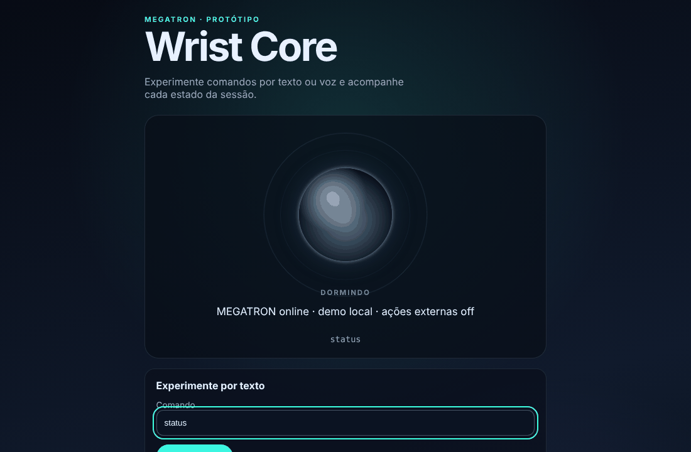

# MEGATRON Wrist Core
[](https://github.com/fabiorabeloj/megatron-wrist-core/actions/workflows/ci.yml) [](LICENSE)

A small **command-interface prototype** with a visual session state machine, optional browser speech input, and an in-memory queue.

Extracted from the FabioOS workspace as a focused, standalone demonstration. It currently simulates responses; it is an early prototype.



[Português](docs/README.pt-BR.md) · [Architecture](docs/ARCHITECTURE.md) · [Contributing](CONTRIBUTING.md) · [Security](SECURITY.md)

## Try it
Requirements: Python 3.12+ to serve the app. Node.js 22+ to run JavaScript tests. Runtime uses the Python standard library and native JavaScript modules; there are no package dependencies to install.

From this repository's root:
```sh
python serve_local.py
```
Open **http://127.0.0.1:8788/** and type:
| Command | Result |
|---|---|
| `status` | Shows a simulated status response |
| `fila` | Shows the simulated pending count |
| `anota revisar documentação` | Simulates a draft |
| `aprovar` | Returns an unsupported-action response |

The **Simular sem adicionar à fila** checkbox starts checked. Uncheck it to add a simulated pending note; reloading the page resets the queue. Commands and the current interface are in Portuguese.

## Optional voice input
The microphone starts disabled. Text input works without microphone permission or an API key. Voice input requires browser support, permission, and a compatible secure context such as loopback localhost.

Browser speech recognition may send audio to the browser vendor's service. Offline recognition is not guaranteed. [Web Speech API behavior](https://developer.mozilla.org/en-US/docs/Web/API/SpeechRecognition)

## Test
```sh
node --test tests/policy.test.mjs tests/session.test.mjs tests/demo.test.mjs
python -m unittest discover -s tests -p "test_*.py"
```
`node --test tests/policy.test.mjs tests/session.test.mjs tests/demo.test.mjs` runs Node's built-in test runner; `npm install` is unnecessary. GitHub Actions runs the suite on Node 22 and 24, on Ubuntu and Windows, with Python 3.12.

## Scope
The demo interprets a small set of phrases and displays session states. It has no gateway, API proxy, persistent storage, LLM, hardware connection, or task executor. Its command policy is an interface convention, not a security boundary for real systems.

## Roadmap
- Review browser behavior and improve accessible interaction.
- Expand intent parsing with ambiguous-input regression cases.
- Define a separately reviewed adapter contract before any real integration.

## License and provenance
[MIT](LICENSE). Adapted from the author's private FabioOS workspace; no third-party assets from it are included. See [COPYRIGHT.md](COPYRIGHT.md).
